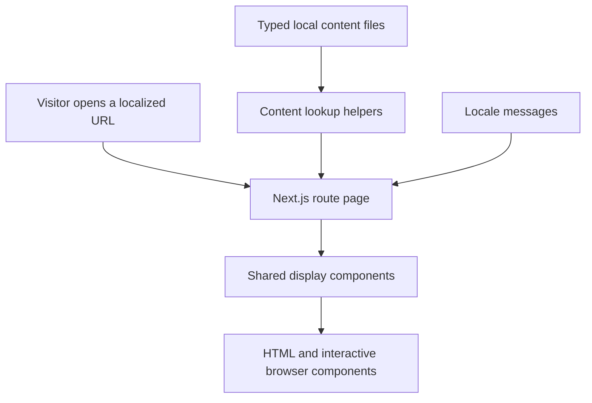

# 04 — Code structure

## 1. Repository map

```text
app/
  [locale]/                 Pages shared by all three languages
    layout.tsx              Document language, fonts, providers, header/footer
    page.tsx                Homepage
    projects/page.tsx       Filterable portfolio
    projects/[slug]/        One reusable project detail route
    services/, about/, team/, contact/
    [...rest]/page.tsx      Unmatched paths enter localized not-found handling
    loading.tsx             Loading skeleton
    error.tsx               Retry UI for route errors
    not-found.tsx           Localized 404 content
    globals.css             Tailwind setup, theme, layout, responsive styles
  sitemap.ts                Localized page URLs
  robots.ts                 Search crawler rules
components/
  site/                     Website sections and interactive components
  ui/                       Existing reusable shadcn/Base UI primitives
lib/
  content/                  Typed local records and lookup/filter helpers
  metadata.ts               Shared page titles/descriptions
messages/                   en.json, ja.json, my.json
i18n/                      Locale routing, request messages, navigation
config/config.ts            Site origin and indexing setting
types/content.ts           Shared content contracts
tests/site.spec.ts         Automated checks
playwright.config.ts        Browser test configuration
proxy.ts                    Locale negotiation and routing
next.config.ts              Next.js, next-intl, and Tailwind configuration
public/images/              Local illustrative photographs
```

## 2. How a page gets its data



For example, `projects/[slug]/page.tsx` gets the URL slug, finds the corresponding project with `getProjectBySlug`, and resolves people with `getProjectTeam`. A missing project enters not-found handling.

There is **no remote API request or database query** in this content flow. `lib/content/data.ts` re-exports records from the individual content modules.

## 3. Server and Client Components

Most route pages and display components render on the server. This means the browser receives useful content without every component needing browser JavaScript.

Files beginning with `"use client"` need browser interaction. Examples include the header’s language switcher, service accordion, timeline, carousel, lightbox, and contact form. They use state, event handlers, or browser APIs.

The locale layout provides `NextIntlClientProvider`, which makes translated messages available to interactive components. A Suspense boundary surrounds the header because pathname-dependent browser behavior must not block prerendering of unknown routes in this Next.js version.

## 4. Libraries and their responsibilities

| Library/tool                     | Current role                                                |
| -------------------------------- | ----------------------------------------------------------- |
| Next.js App Router               | Routes, server rendering, image handling, metadata, build   |
| React and TypeScript             | Components and checked data/prop contracts                  |
| Tailwind CSS and theme variables | Styling and responsive behavior                             |
| shadcn/Base UI primitives        | Reusable accessible inputs, accordion, and sheet/dialog     |
| next-intl                        | Message lookup, locale routing, and locale-aware navigation |
| Motion                           | Reveals, image transitions, scroll timeline                 |
| Embla Carousel                   | Testimonial slides                                          |
| Yet Another React Lightbox       | Enlarged project gallery                                    |
| React Hook Form + Zod            | Form state and validation                                   |
| Lucide React                     | Icons                                                       |
| Fontsource                       | Locally hosted Manrope and Noto Sans Myanmar                |
| Playwright                       | Browser automation and assertions                           |
| ESLint / TypeScript / Prettier   | Linting, type checking, formatting                          |

Some starter dependencies and UI components are installed but unused by this website. An installed chart package, for example, does not mean the app has a reporting dashboard. Axios, TanStack Query, Zustand, authentication, and a backend have not been implemented for this local-data site.

## 5. Design and rendering choices

The theme intentionally combines ivory, charcoal, and amber. It has no theme-switching interface. Photography is the supported fallback for unavailable transparent cutout assets; `cutoutImage` exists in the contract but is not rendered by the current cards.

`next.config.ts` enables Cache Components and partial prefetching. Many pages are generated ahead of time; the project listing streams request-dependent filter results inside Suspense. Follow the repository’s `AGENTS.md` and the installed guides in `node_modules/next/dist/docs/` before changing Next.js conventions.

Next: [05 — Content and languages](05-content-and-languages.md).
